# UVScan user guide

UVScan reads live data, trouble codes and vehicle information from GM vehicles on the **Class 2 / J1850 VPW** bus through an **AVT‑841** (or 838 / 842) interface or an **ELM327** type adapter (Bluetooth, USB or Wi‑Fi), logs it to CSV, shows it as a grid or as gauges with alerts, and can send real‑time control commands. It was written for the 1996‑2005 GM V6s (3100 / 3400 / 3800) but works with any Class 2 PCM.

- [Installing](#installing)
- [The main window](#the-main-window)
- [Phones and tablets](#phones-and-tablets)
- [Connecting](#connecting)
- [Quick start](#quick-start)
- [Choosing PIDs and scan lists](#choosing-pids-and-scan-lists)
- [Live data](#live-data)
- [Live chart](#live-chart)
- [Display and alerts](#display-and-alerts)
- [Dashboard](#dashboard)
- [Test display](#test-display)
- [Logging](#logging)
- [Log viewer](#log-viewer)
- [Vehicle and trouble codes](#vehicle-and-trouble-codes)
- [Real‑time controls](#real-time-controls)
- [Tools](#tools)
- [Editing PIDs](#editing-pids)
- [Finding PIDs a PCM supports](#finding-pids-a-pcm-supports)
- [About](#about)
- [Messages](#messages)
- [Keyboard and command line](#keyboard-and-command-line)
- [Where things are stored](#where-things-are-stored)
- [Troubleshooting](#troubleshooting)

Nearly all screenshots and clips were taken with the built‑in **Simulator**, so the values are made up (it drives a pretend car, so they behave like real ones); the Wi‑Fi adapter ones are from a real adapter and a PCM on the bench, engine off. The clips are short animations; click one to open it as a video you can pause and scrub. More of them, for both platforms, are on the [wiki](https://github.com/jdredd87/UVSCAN/wiki/Demos).

---

## Installing

**Windows:** download `UVScan-<version>-build<n>-setup.exe` from the [latest release](https://github.com/jdredd87/UVSCAN/releases/latest) and run it. It asks whether to install for you only (no admin needed) or for all users of the PC, then adds UVScan to the Start menu and the desktop (untick *Create a desktop shortcut* if you don't want that one). The setup program is not signed yet, so Windows may say *Windows protected your PC*: click *More info*, then *Run anyway*. Running a newer setup updates UVScan in place. To remove it, *Settings → Apps → UVScan → Uninstall*; your PIDs, lists, settings (`C:\ProgramData\UVScan`) and logs stay.

**Android:** install `UVScan.apk` (allow installs from the app that opens it, a file manager say).

**Updates:** once a day, a few seconds after it starts, UVScan asks GitHub whether there is a newer release. If there is, it says what is new and offers to install it: on Windows it downloads the setup program and closes; the setup shows just a progress window, keeps the choices made when UVScan was installed and starts UVScan again (installed for all users, Windows first asks for permission) (your data and logs stay); on a phone it opens the release page. While a scan or a log is running it only shows a notice, so a drive is never interrupted. *More → About* shows what the last check found, has **Check now**, and **Check for updates at start** turns the daily check off (nothing is sent but the request for the latest release). On an adapter's own Wi‑Fi there is no internet, so the check says *no internet connection* and tries again the next time UVScan starts.

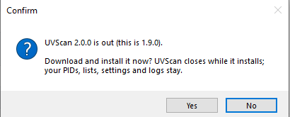

## The main window

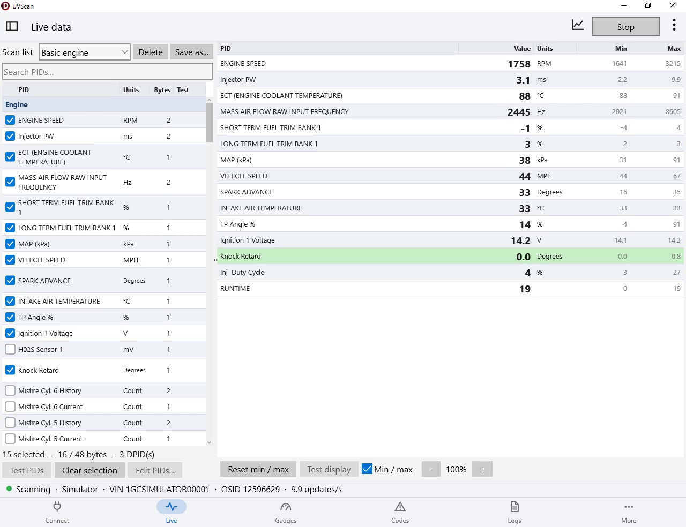

Windows and Android share one layout:

| Area | What it is |
|---|---|
| Top bar | The page's title, one main button that follows the connection (**Connect** → **Start scan** → **Stop**), and **⋮** with the page's other actions. Pages under *More* get a back arrow. On Android the back button or gesture does what the arrow does: it leaves an editor or sub‑page (asking first if there are unsaved changes), goes from a *More* page to the menu and from any page to *Live*; on *Live* it sends UVScan to the background like Home (a scan carries on for the time set in *Settings → Logging*). |
| Pages | **Connect** (adapter, scan, logging, vehicle info), **PIDs** (the PID list with the **Scan list** row, the byte count — the PCM streams at most 48 — and **Test PIDs / Clear selection / Edit PIDs…**), **Live** (live data grid), **Gauges** (dashboard), **Codes** (trouble codes), **Logs** (opens the log viewer) and **More**: *Real‑time controls*, *Tools*, *Settings*, *Messages*. A coloured notice line appears at the top when something needs your attention (tap or click it to dismiss). |
| Status strip | A dot — grey idle, blue connected, green scanning, red logging, amber paused — then state, port, VIN, OS ID, update rate and logging. Tap it to go to *Connect*. |
| Tab bar | **Connect · PIDs · Live · Gauges · Codes · Logs · More** at the bottom (down the left side when the phone is held sideways). |

On a wide window (about 1000 pixels and up — a big Windows window, or a tablet held sideways) the PID list stays docked on the left beside the pages (drag the splitter to size it) and the *Live* and *Gauges* pages show their buttons in a bar; on a phone or a narrow window those buttons are in the **⋮** menu.

**More room for the pages:** the **‹** button at the end of the *Scan list* row (or the button at the left of the top bar, **Ctrl + L**, or **⋮ → PID list beside the pages**) puts the PID list away, also while scanning, and gives it a page of its own, **PIDs** in the tab bar, as on a phone. The **›** strip down the left edge (or the same top bar button, or Ctrl + L) brings it back. UVScan remembers which you chose.

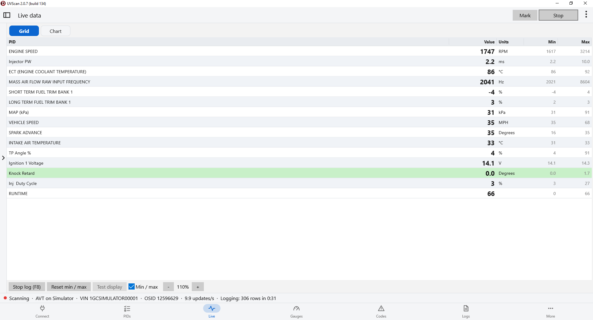

A phone works upright or sideways. Held sideways (a short, wide screen) the tab bar moves down the left side so the pages keep their height, the PID search sits beside the scan list, *Real‑time controls* shows the selected control beside the list, the gauge editor keeps its preview beside the fields, and the log viewer puts its log box in the top bar, playback on one row and the chart beside *Channels | Data*.

Everything fits the width it has: on a phone or a narrow window the grids drop or narrow their less important columns and wrap long names onto more lines, a number too long for its cell is drawn smaller rather than cut short, and a grid whose columns still do not fit scrolls sideways (drag it with a finger, or Shift + mouse wheel). The editors (gauges, *Display & alerts*, PIDs, real‑time controls, PID search) open as pages with the same top bar: the back arrow cancels, the button on the right saves.

**Themes** (*More → Settings → Theme*): **System default** follows the light / dark setting of Windows or the phone; or pick **Light** or **Dark**. They are Delphi's own styles (Win10Modern on Windows, the Android styles on a phone). **Keep the screen on while UVScan is open** (same page, on by default) stops the phone or PC from going to sleep or blanking the screen.

**Round readings on gauges and live data** (same page, on by default) shows each PID with a fixed number of decimals that suits it, so numbers do not flicker or jump sideways: throttle, RPM, temperatures, trims and speed as whole numbers (44 %, not 44.31 %), volts, knock retard and injector pulse with one decimal (13.8 V, 0.4°), O2 volts and gear ratios with two (0.45 V). The live list's min / max columns follow it too. Logs and the log viewer always keep every digit. Turn it off to see readings exactly as the formula gives them.

## Phones and tablets

The layout follows the room it has, not the platform: a narrow Windows window looks like a phone, a tablet held sideways like the desktop.

<p>
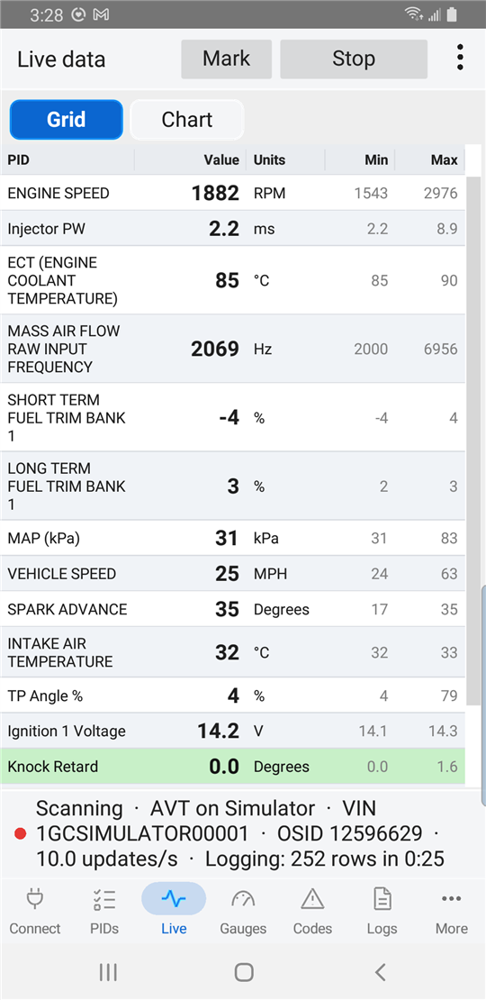
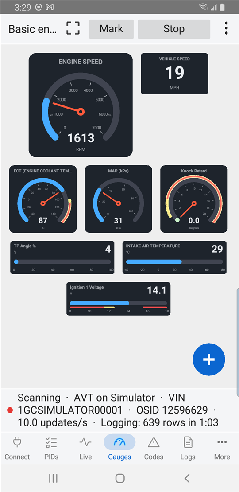
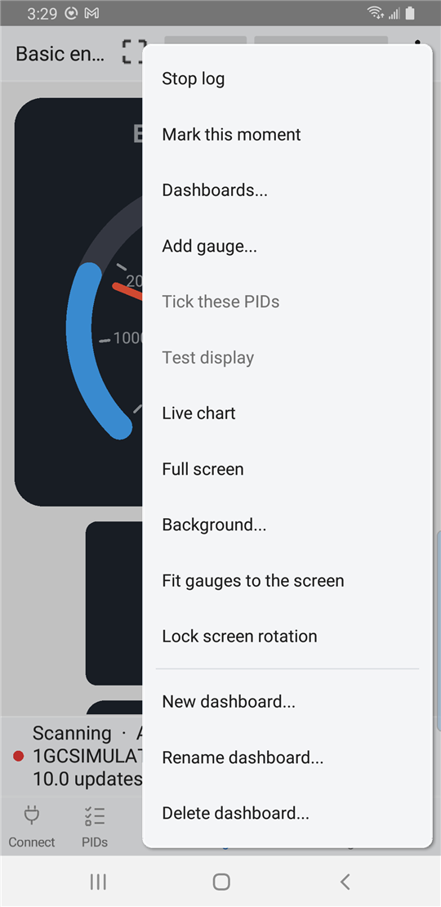
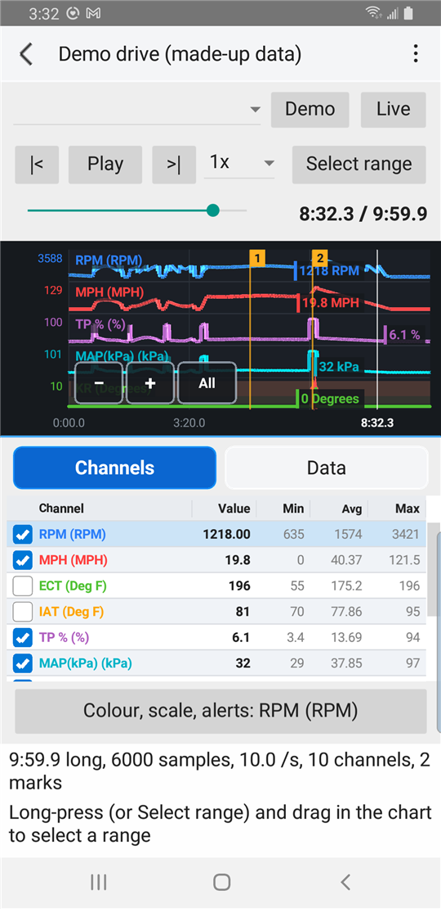
</p>

Held sideways the tabs go down the left side and the pages keep their height:

<p>
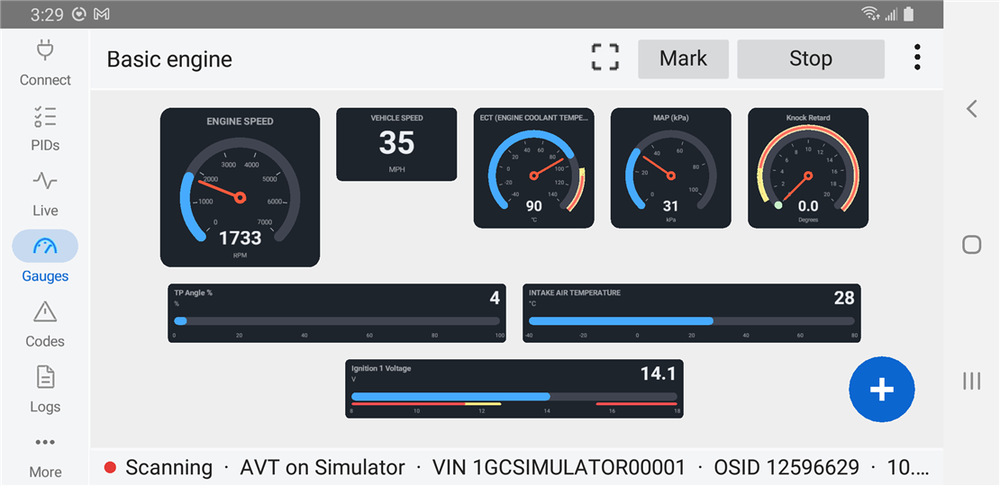
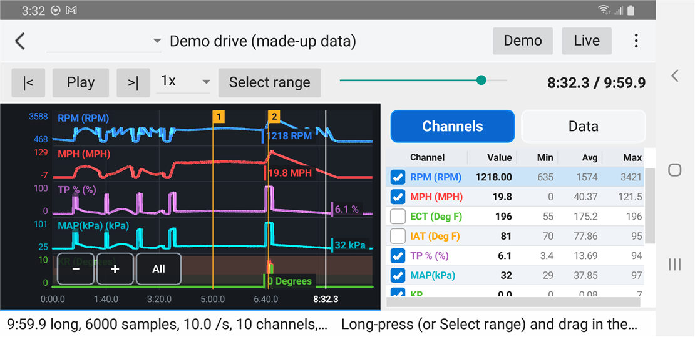
</p>

[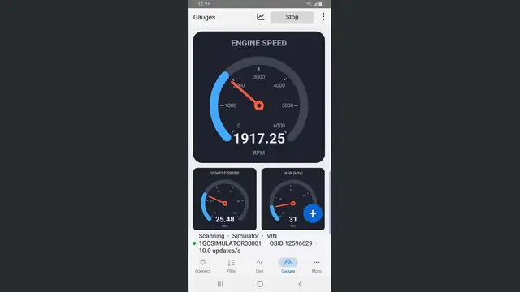](media/phone-rotate.mp4)

A tablet held sideways keeps the PID list docked beside the pages:

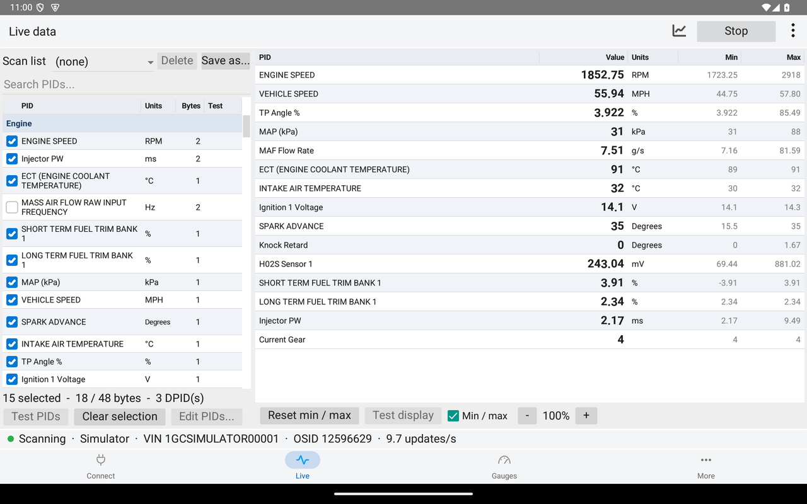

**Windows tablets** turn too: UVScan lays out for the new shape, and a window that no longer fits the screen (the log viewer and the PID editor are big) is made to fit, as it is whenever one opens. **Esc** does what the back button does on a phone — closes an open **⋮** menu, or leaves an editor (asking first if you changed something).

[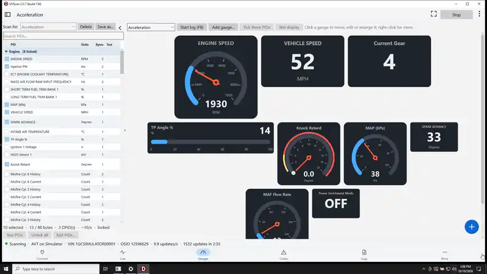](media/win-resize.mp4)

## Connecting

1. Plug the adapter into the vehicle (key on): an **AVT‑841** on the PC or phone (serial, USB, or the network), or an **ELM327** type adapter (Bluetooth, USB or Wi‑Fi; see [ELM327 adapters](#elm327-adapters)).
2. On the *Connect* page choose the adapter (**AVT**, for an AVT‑838, 841 or 842, or **ELM327**), then its COM port, or on Android its USB adapter or paired Bluetooth adapter (**Refresh** re‑reads the list), and the baud rate (115200 for the AVT‑841, usually 38400 for a USB ELM327; Bluetooth has none). Choose **Simulator** to try UVScan without hardware: it acts as the adapter you chose.
   An AVT with an **Ethernet port** (or any AVT behind a serial‑to‑network adapter) is **Network (TCP/IP)**: type its address and port in the box that appears, e.g. `192.168.2.99:10001` (port 10001 if you leave it out). It works the same from a PC or a phone on the same network. UVScan gives up after 5 seconds if nothing answers. (So far this has been tried only against the simulator; [testing with a network AVT](network-avt-testing.md) is a checklist for anyone who has one.)
3. Press **Connect** (on the page or in the top bar). UVScan initialises the adapter, reads its firmware version, the VIN and the PCM operating system ID (shown in the status strip and under *Vehicle* on the *Connect* page).

Everything that talks to the adapter runs on a background thread, so the window stays responsive while the PCM is busy.

### ELM327 adapters

Any ELM327 type adapter that supports **J1850 VPW** works: clones, OBDLink / STN based ones (the vLinker FD was used to test it), Bluetooth, USB or Wi‑Fi. UVScan uses only the standard ELM327 commands. Many cheap "v2.1" clones have no VPW at all; UVScan says so when it connects.

| Adapter | How |
|---|---|
| **Bluetooth, Android** | Pair it first in Android's Bluetooth settings (the PIN is usually **1234** or **0000**). Paired devices show in the port list as **BT** *name* **[address]**; choosing one sets the adapter to ELM327. Android 12 and later ask once to let UVScan use nearby devices. |
| **Bluetooth, Windows** | Pair it in Windows' Bluetooth settings. Windows makes it a COM port (*Standard Serial over Bluetooth link (COM4)*, say); choose that port and **ELM327**. |
| **Wi‑Fi** | Join the adapter's own Wi‑Fi network, then choose **Network (TCP/IP)** and type its address, usually `192.168.0.10:35000` (port 35000 if you leave it out with ELM327 chosen). |
| **USB** | Its COM port (on Android its USB adapter), usually at 38400. |

Everything works as with the AVT (live data at about 10 updates a second, logging, dashboard, trouble codes, PID test and search, real‑time controls, VIN write) except the **analog inputs**, which are the AVT's own: an ELM327 scan leaves them empty. A Bluetooth or Wi‑Fi link can delay data a little now and then (a phone's Bluetooth more than a PC's); none of it is lost. The ELM327 has to stop listening for a moment every 2 seconds to send the "tester present" message that keeps the PCM streaming.

#### A Wi‑Fi adapter

Tried with a common clone (its network is *WIFI_OBDII*, open, and it says *ELM327 v1.5*): about 10 updates a second on a PC and on a phone, the same as Bluetooth. The adapter takes one connection at a time, so close UVScan on one device before connecting from another.

- **Windows:** join *WIFI_OBDII* (Windows says *No internet*; that is right), then *ELM327*, *Network (TCP/IP)*, `192.168.0.10:35000`, **Connect**. A PC with a network cable keeps its internet through that; one with only Wi‑Fi has none while it is on the adapter.
- **Android:** join *WIFI_OBDII* in the Wi‑Fi settings. The phone says *Internet may not be available*: choose **Keep Wi‑Fi connection** (it then stays on this network whenever it is in range; forget the network to undo that). Then the same as on Windows.

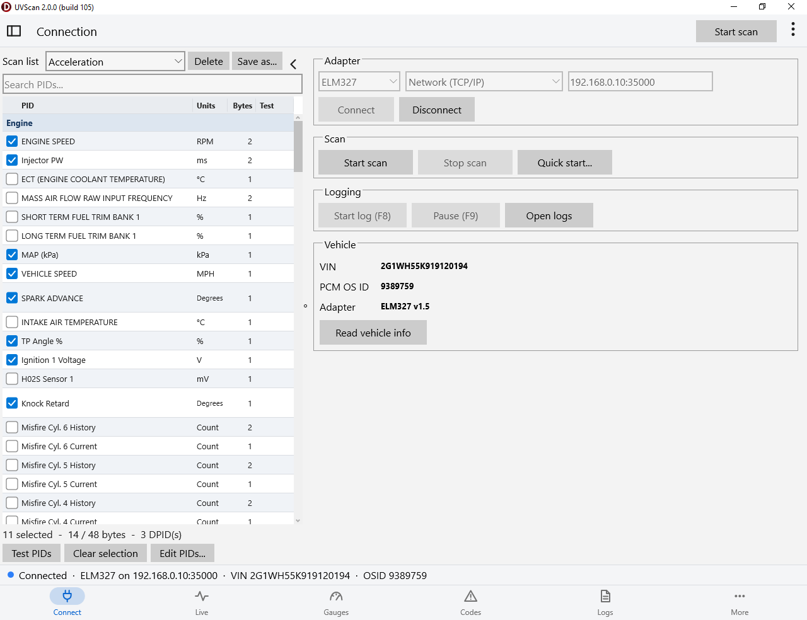

<p>
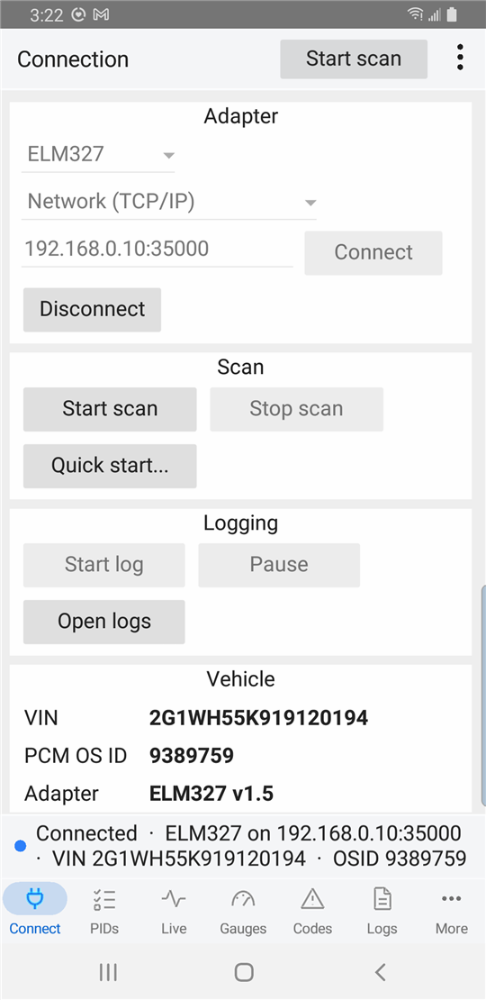
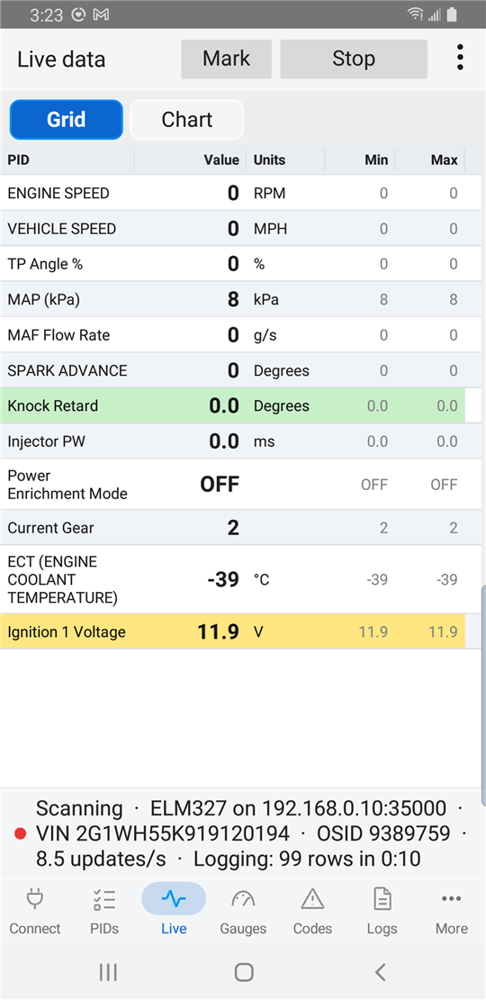
</p>

## Quick start

When there is no time to set things up — at the drag strip, say — a **quick start** does it all in one go: picks a scan list and a dashboard, connects, starts scanning and a log, opens the dashboard full screen or the live chart, and can keep trying to connect until the adapter and car answer.

[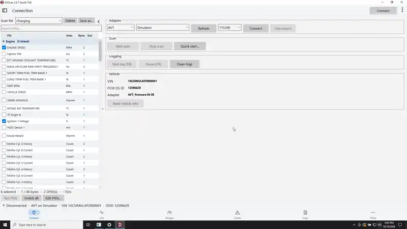](media/win-quick-start.mp4)

- **Quick start…** on the *Connect* page (also in its **⋮** menu) lists them; pick one to run it. UVScan comes with **Drag strip**: the *Acceleration* scan list and dashboard, connect, scan, log, full screen, keep trying.
- **New quick start…** starts from the scan list and dashboard chosen now; **Edit…** and **Delete…** pick one first. The page has its name, the **Scan list** (or *keep the ticked PIDs*), the **Dashboard** (or the scan list's own) and what to do then: *Connect*, *Start scanning*, *Start a log*, *Dashboard on the whole screen*, *Open the live chart*, *Keep trying to connect until the car answers*. A log needs a scan and a scan needs the connection, so ticking one ticks what it needs.
- **Keep trying** connects again every 3 seconds while it is not connected — the adapter not plugged in yet, or the link to it lost later — and starts the scan and log again each time. A port chosen before that is not plugged in yet stays chosen, so a shortcut started before the adapter is plugged in connects as soon as it is. On a phone, being stopped for staying away from UVScan too long (*Settings → Logging*) ends the quick start: it does not connect again in the background. (If the PCM goes quiet during a scan, say the key is turned off, the scan itself keeps asking it to stream again.) The top bar's button says **Stop trying** meanwhile; **Stop**, **Disconnect** or that button end the quick start.
- **Desktop shortcut for one…** (Windows) puts a shortcut on the desktop that starts UVScan straight into it. The shortcut holds the [command line](#keyboard-and-command-line) for it (e.g. `-list "Acceleration" -log -fullscreen -retry`), so it keeps working even if the quick start is renamed or deleted; it uses the port and adapter chosen last unless the quick start names them.

<a href="media/phone-quick-start.mp4">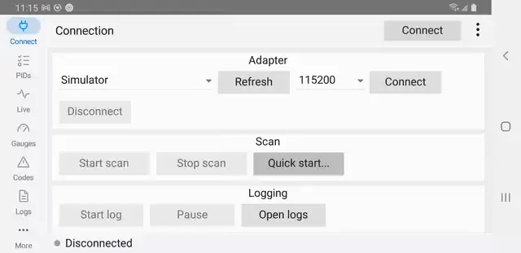</a>

Quick starts are kept in `settings.json`. On a phone they are on the same menu (Android has no command line or desktop shortcuts).

## Choosing PIDs and scan lists

Tick PIDs on the *PIDs* page, or in the list on the left of a wide window (type in **Search PIDs…** to filter). The footer shows how many are ticked and how many of the PCM's 48 streaming bytes they use; it turns red when there are too many.

The ticks are what the scan asks the PCM for, so they are locked while scanning (the check boxes fade, the footer says *locked*): **Stop scan**, change them, **Start scan**. Everything else stays usable while scanning: the search, *Display & alerts*, *Add to dashboard*, the rows' order and the PID list put away.

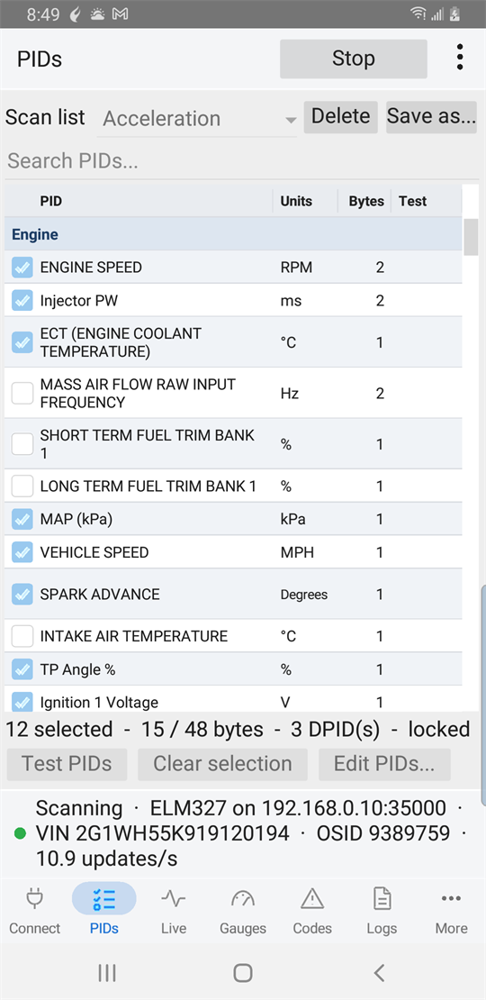

- **Test PIDs** asks the PCM about each ticked PID (or all of them) and shows *yes / no* in the *Test* column.
- **Scan list** holds named selections such as *Misfires* or *Transmission*. Pick one to tick its PIDs, **Save as…** to store the current ticks under a name, **Delete** to remove a list. Lists only remember which PIDs, so fixing a PID's formula fixes it in every list.
- UVScan comes with a scan list for each common job, and each has a [live chart](#live-chart) view of the same name:

| Scan list / view | For | Charts |
| --- | --- | --- |
| Basic engine | A first look at any engine | RPM, MPH, TP %, MAP, ECT, IAT, STFT, LTFT, KR, IGN V |
| Warm-up | Cold start to closed loop: thermostat, idle settling, fans | ECT, IAT, RPM, Desired Idle, IAC Position, Loop, STFT, Fans Low |
| Idle | Rough or hunting idle, vacuum leaks | RPM, Desired Idle, IAC Position, MAP, Spark, STFT, Load |
| Fuel trims | Lean / rich problems, O2 sensors (trims beyond ±10 % yellow, ±20 % red) | STFT, LTFT, O2, HO2 B1S2, Loop, FT Cell, RPM, MAP |
| Knock check | Spark knock under load | RPM, TP %, MAP, Spark, KR, IAT |
| Acceleration | A pull: power enrichment, airflow, timing, knock | RPM, MPH, Gear, TP %, MAP, MAF (g/s), Spark, KR, PE Mode |
| Charging | Battery / alternator: voltage against the generator's duty | IGN V, Gen PWM, RPM, Fans Low / High, Gen Lamp |
| Cooling | Overheating: when the fans come on | ECT, Fans Low / High, IAT, Trans Temp, MPH, Hot Lamp |
| Transmission | Shifts, converter lock-up, line pressure | RPM, MPH, Gear, TP %, TCC Slip, TCC %, PC %, Trans Temp |
| Misfires | Which cylinder misfires, and when | RPM, Misfires, Misfire Cyl. 1–6 Current |

  Not every PCM has every PID: **Test PIDs** shows which ones yours answers. An update of UVScan adds new built-in lists and views to yours; ones you deleted stay deleted.
- Right‑click a PID (long‑press on a phone) → **Display & alerts…** or **Add to dashboard…**.

## Live data

Press **Start scan**. Each ticked PID gets a row with its current value, units and the lowest / highest value seen (**Reset min / max** starts those again).

- **Min / max** in the footer (or **⋮ → Show min / max**) hides or shows those two columns.
- **‑ / +** zoom the grid from 75 % to 250 % — text, rows and columns together. Ctrl + mouse wheel over the grid, Ctrl + plus / minus and Ctrl + 0 (back to 100 %) do the same. Click the percentage to reset.
- Rows take the colours of their [alert levels](#display-and-alerts) and flash when a level says so.
- **Rows in your order**, also while scanning: right‑click a row (long‑press on a phone) → **Move up**, **Move down**, **Move to the top** or **Move to the bottom**, or select it and press **Alt + Up / Alt + Down**. Only what is shown changes, not what is asked of the PCM. Each scan list keeps its own order (and **Save as…** stores the rows' order); without a scan list the order is remembered for the next scan.
- With up to 4 DPIDs (about 24 bytes of PIDs) the PCM sends about 10 updates a second, with more about 5 (see [protocol notes](protocol.md)).

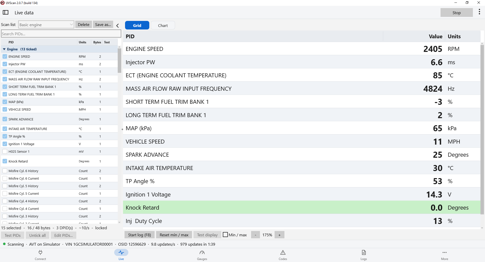

[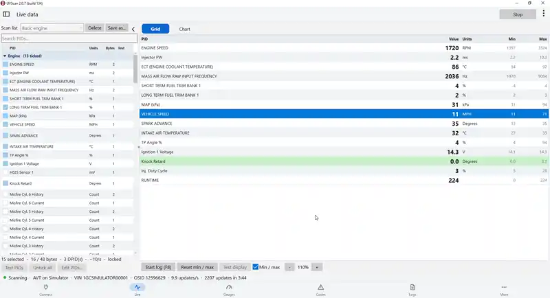](media/win-live.mp4)

<a href="media/phone-live.mp4">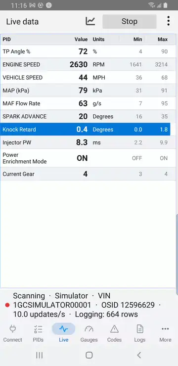</a>

## Live chart

**Grid | Chart** at the top of the *Live* page switches between the grid and the live chart: the running scan as a line chart — the [log viewer](#log-viewer)'s chart, fed by the scan instead of a file. The chart button in the top bar (on *Live* and *Gauges*, or **⋮ → Live chart**) goes to it too, and on the chart back to the grid. It also charts the [test display](#test-display), so you can try it without a car. On a narrow window or a phone, **⋮ → Chart view, colours and scales…** has what does not fit in its bars.

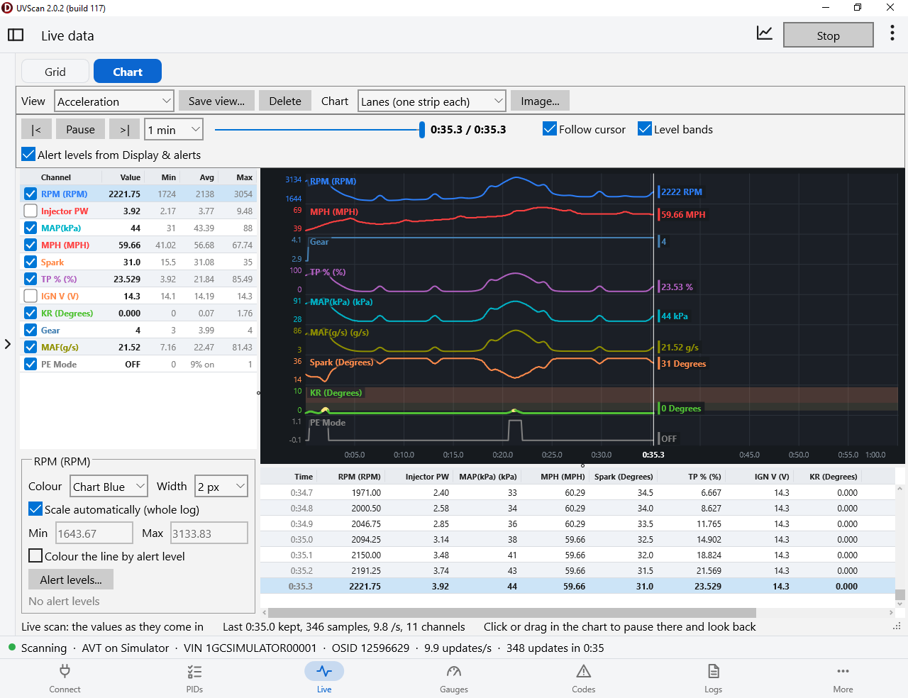

- The newest values are on the right and the chart scrolls as they come in. The box after the buttons sets how much it shows: 15 s, 30 s, 1, 2, 5 or 10 minutes (remembered).
- Every update of the scan is charted (about 10 a second with up to 4 DPIDs), and the last 15 minutes are kept while you scan, so you can open the chart after something happened and still see it.
- **Pause:** click, drag or touch the chart (or press **Pause** / Space) to stop it scrolling and put the cursor there. The values on the left are then the ones at the cursor; the slider, **|<**, the mouse wheel, panning and selecting a stretch (for min / avg / max) all work as on a log. **Live** (or **>|**) goes back to now.
- Channels, colours, widths, scales, alert colours, level bands, chart modes and saved **views** are the same as in the log viewer. The channels are named like the columns of a log, so a view saved for logs works on the live chart and the other way round.
- **Image…** saves the chart as it is. Saved logs open in the [log viewer](#log-viewer) (**F7**, *Logs*), a window of its own on Windows.
- A new scan starts the chart again with its PIDs. Started from a scan list that has a view of the same name (all the built-in ones do), the chart switches to that view.
- In **Lanes** the strips are in the order the view lists its channels.

## Display and alerts

Right‑click a PID in the list or a row in the live grid → **Display & alerts…**.

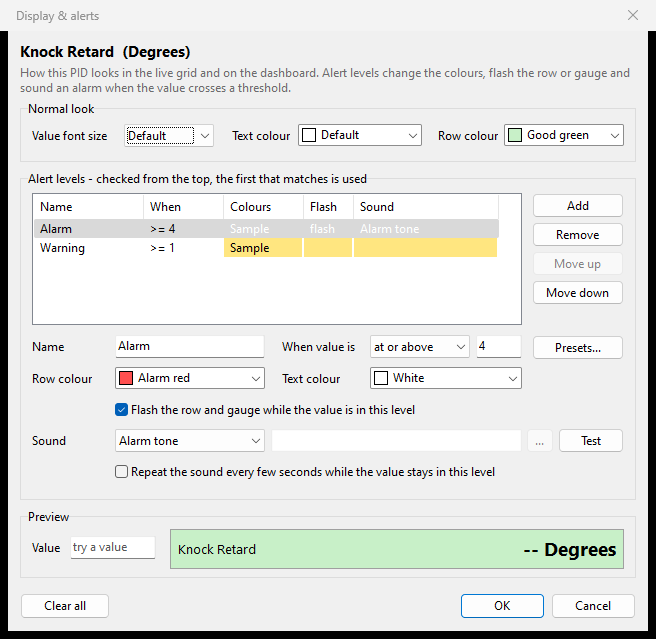

**Normal look** — the size of the value text and the row's text and background colour (for example a pale green row for knock retard, so it stands out).

**Alert levels** — checked from the top; the first one that matches the current value is used. Each level has:

| Setting | Meaning |
|---|---|
| Name | Shown in the grid preview, on the gauge and in Messages (*Alarm*, *Hot*, …). |
| When value is | *at or above, above, at or below, below, equal to, not equal to* a number. |
| Row colour / text colour | The colours while the level is active (*Default* keeps the normal look). |
| Flash | The row and the gauge blink while the level is active. |
| Sound | *Beep* or *Alarm tone* (built into UVScan, so they work even with Windows sounds off), the *Windows alert sound*, or any `.wav` file. **Test** plays it. |
| Repeat | Play the sound again every few seconds while the value stays in the level. |

A sound plays when a PID **enters** a level, at most once every 3 seconds per PID, so a value hovering on a threshold does not machine‑gun. Each alert is also written to Messages. **Play alert sounds** (*More → Settings*) mutes all of them.

**Presets…** builds green / yellow / red from two numbers: *high values are bad* (knock retard, temperatures) or *low values are bad* (voltage, oil pressure). The red level flashes and sounds the alarm tone.

Type a number in **Preview** to see how the row looks at that value.

Built‑in examples (created the first time UVScan runs, matched to your PIDs by PID code): knock retard (warning ≥ 1°, alarm ≥ 4°), coolant temperature (hot ≥ 104 °C, overheating ≥ 110 °C with a repeating alarm) and ignition voltage (overcharging ≥ 15.5 V, low ≤ 11.5 V, not charging ≤ 12.6 V).

## Dashboard

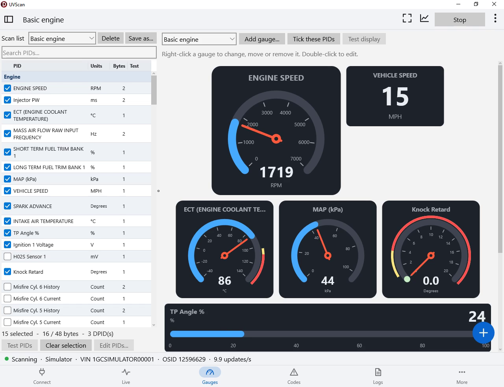

Big gauges for the PIDs you care about most:

- **Dial** — 270° scale with needle and the value in the middle,
- **Bar** — a horizontal bar with the value on the right,
- **Big number** — just the value, large.

Each comes in small, medium or large and has its own scale. Gauges are laid out in rows to fit the window, and a gauge shorter than its row goes under the one before it when both fit (two small dials beside a large one). On a phone small gauges sit two to a row (six dials fit on the screen), medium ones keep their size, large ones fill the width and bars take the width; held sideways, two rows of small gauges fit the screen.

They follow the **same alert levels** as the grid: the scale shows the levels as coloured bands, the value arc takes the colour of the band it is in (or the PID's normal colour), and while a level is active the whole card takes the level's colours, flashes and sounds.

- **Add gauge…** or right‑click a PID → **Add to dashboard…**
- Right‑click a gauge (long‑press on a phone) → **Edit gauge…**, **Display & alerts…**, **Minimize**, **Move earlier / later**, **Remove from dashboard**. Double‑click edits.
- **Minimize** shrinks a gauge to a small chip — its name and value, still in its alert colours — in a row at the bottom, to make room for the others for a while. Tap or click the chip to restore it.
- **Tick these PIDs** ticks the dashboard's PIDs in the PID list, ready to scan (not while scanning).

**Full screen.** The full‑screen button in the top bar (or **F11**, or **⋮ → Full screen**) shows the dashboard alone on the whole screen — no bars, tabs or PID list, on a phone not even the status and navigation bars — with the gauges as big as they go while all of them still fit. A virtual dash for driving or a run down the strip. With no status strip there, a red label at the top says when it is not scanning (*Not connected – trying again*, *Connected – not scanning*), since the gauges keep showing the last values. **Esc**, the back button or gesture, or the small round button in the top right corner come back. A [quick start](#quick-start) can open it straight away.

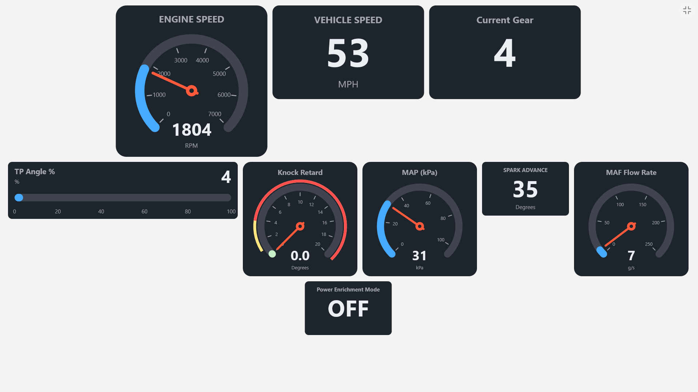

**Quick buttons on a gauge.** Tap or click a gauge and a row of round buttons shows on its top right corner for a few seconds:

| Button | Does |
|---|---|
| ‹  › | Move the gauge earlier or later on the dashboard. The buttons stay with it, so tapping again keeps moving it. |
| ⚙ | Edit the gauge (PID, style, size, scale, alert levels). |
| ⛶ | That gauge alone fills the screen. On the big gauge it is the way back to all of them (so are **Esc**, back and the corner button); started from the normal page, that also leaves full screen. |

The same are in the right‑click / long‑press menu (**Fill the screen**, **Move earlier / later**, **Edit gauge…**).

**Fit gauges to the screen** (**⋮**, per dashboard) scales all the gauges up or down so they fill the page with no scrolling, keeping clear of the minimized chips and the **+** button. It works again whenever the window changes size or the phone turns; full screen always fits.

**Lock screen rotation** (phones and tablets: **⋮** on *Live* and *Gauges*, or *Settings → Appearance*) keeps the screen the way it faces now, so a bump in the car does not turn it. Turn it off the same way.

**Background.** **⋮ → Background…** gives each dashboard its own background: **Plain** (the theme's), a **Solid colour** (black makes a good night dash), or a **Picture** — a file on Windows, the photo picker on a phone. The picture is scaled to cover the page (cut at the edges, never stretched) and kept in UVScan's data folder (`images`), so the original can be moved or deleted. **No picture** removes it.

**Several dashboards.** The box at the left of the Gauges bar (on a phone **⋮ → Dashboards…**) picks which one is shown; the top bar shows its name. **⋮ → New / Rename / Delete dashboard…** manage them. UVScan comes with one for each of its [scan lists](#choosing-pids-and-scan-lists) (*Basic engine*, *Warm-up*, *Idle*, *Fuel trims*, *Knock check*, *Acceleration*, *Charging*, *Cooling*, *Transmission*, *Misfires*), and starting a scan from a scan list shows the dashboard of the same name, so a list of your own gets its dashboard by giving both the same name. The gauges of an older UVScan are the dashboard *Main*.

<table><tr>
<td valign="top"><a href="media/win-dashboard.mp4">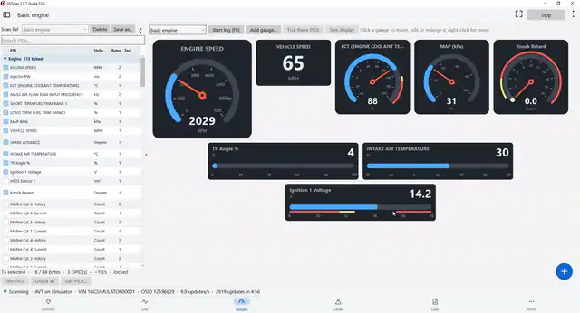</a></td>
<td valign="top" width="250"><a href="media/phone-dashboard.mp4">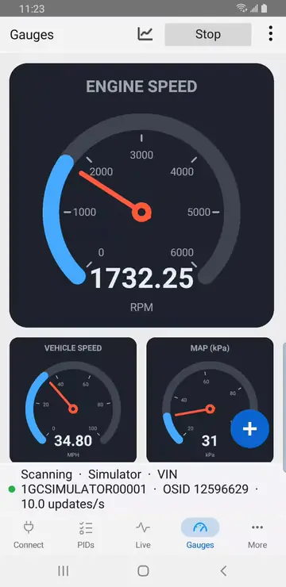</a></td>
</tr></table>

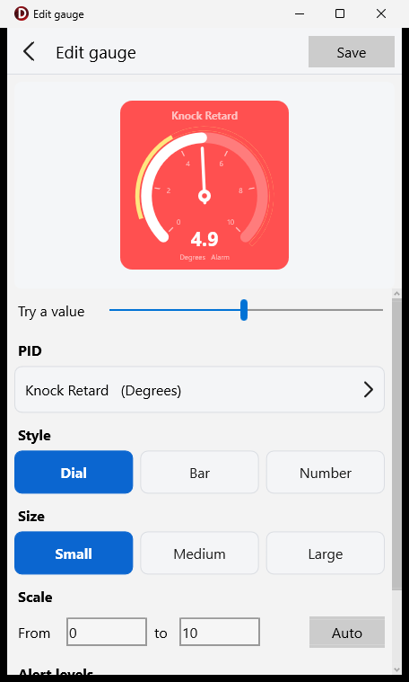

The gauge editor shows the gauge at the top; drag **Try a value** to see it at any value, including flashing levels. Tap the **PID** row to pick another PID (with a search box), choose **Dial / Bar / Number** and **Small / Medium / Large**, and set the scale — **Auto** suggests one from the PID's formula and widens it to show every alert level. **Edit alert levels…** opens *Display & alerts* for the PID: each level is a card (tap it to change its name, condition, colours, flashing and sound), **+ Add level** and **Presets…** add more.

## Test display

**Test display** (on the *Live* and *Gauges* pages or in their **⋮** menu, whenever you are not scanning) fills the grid and the gauges with made‑up values that slowly rise and fall through each PID's range — its gauge scale, widened so every alert threshold is crossed. Use it to check colours, flashing, sounds and gauge layouts without a car. A notice says the values are made up; nothing is sent to the PCM and nothing is logged. Press **Stop test** (or start a real scan) to end it.

## Logging

While scanning, **Start log (F8)** (on the *Connect* page, the *Live* and *Gauges* bars, and their **⋮** menus) writes every update to a CSV file named `UVScan_<date>_<time>.csv` in the log folder (default *Documents\UVScan Logs*, change it in *More → Settings*). **Pause (F9)** stops writing rows without closing the file. While it logs, the status dot is red and the strip counts the rows written (*Logging: 1234 rows*). The first column is the time since the log started, then one column per PID with its units in the header.

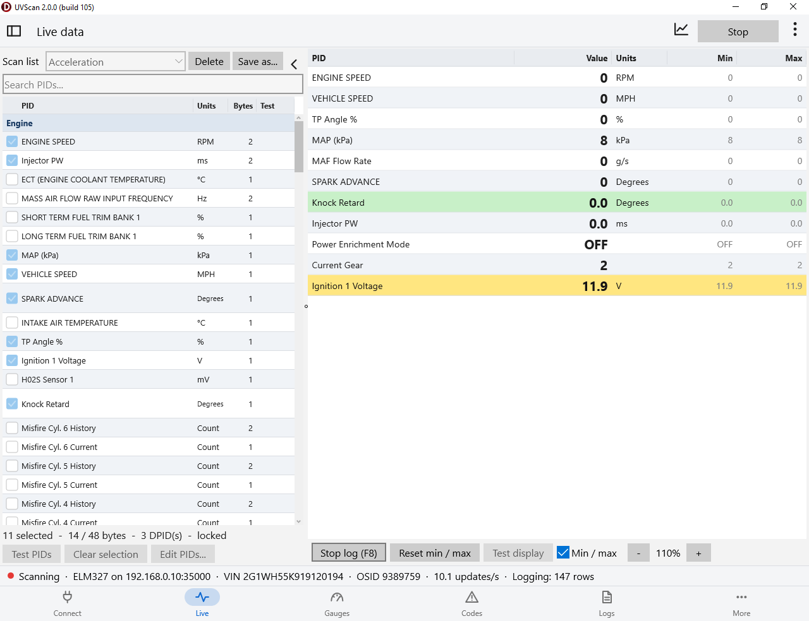

**On a phone, stay in UVScan while logging.** Android lets an app it is not showing run for only a short while before pausing it, which would cut the stream off part‑way. So when you switch to another app (or the screen turns off) UVScan waits; if you are not back within the time set in *Settings → Logging* (**Stop and disconnect when away for**, 15 seconds unless you change it), it closes the log, stops the scan, releases any held controls and disconnects. The rows recorded until then stay in the log. While you are away a notification says UVScan is still connected, scanning or logging and how long it will wait (tap it to go back); if the time runs out it changes to say what was stopped. When you come back the notification goes and a notice in UVScan says what was stopped (even if Android has closed UVScan meanwhile); connect and start again. Back sooner, and everything just carries on. Android 13 and later ask once, the first time you connect, whether UVScan may show notifications. Keep the screen on (*Settings → Appearance*) so it does not turn off by itself mid‑drive.

## Log viewer

**Logs** in the tab bar, **Open logs** on the *Connect* page (or **F7**) opens your logs as a chart and a grid that follow one cursor. The first time it opens the newest log in the log folder; **Open log…** picks any file and the list next to it holds the 40 most recent. **Demo drive (made up)** opens a generated 10‑minute drive (cold start, city, highway, a hard pull with knock retard) to try everything without a log.

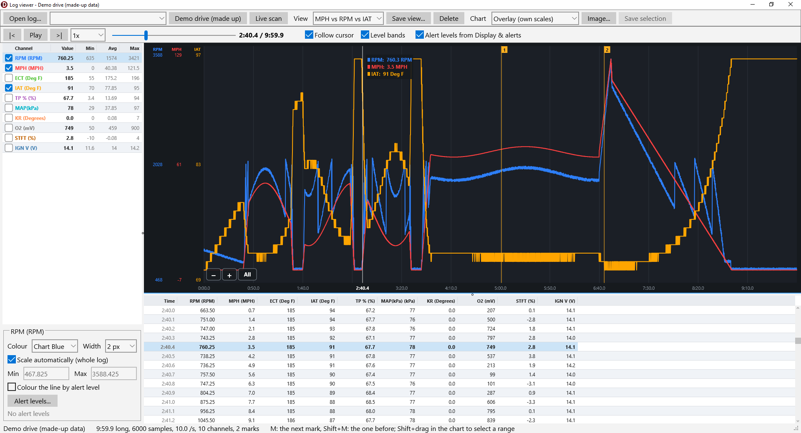

**Channels** (left): tick the ones to chart. *Value* is the value at the cursor, coloured by its alert level; *Min* / *Avg* / *Max* are for the whole log (or the selected stretch, see below). Select a channel to change it:

| Setting | What it does |
|---|---|
| Colour, width | The line. |
| Scale automatically | Fits the whole log; untick it and type a min and max to fix the scale (e.g. 0‑10° for knock retard so small blips stay small). |
| Colour the line by alert level | Where an alert level matches, the line takes the level's colour and gets thicker. |
| Alert levels… | Levels for this channel in this view, with the same dialog as *Display & alerts*. Without its own levels a channel uses the *Display & alerts* levels of the PID with the same name and units (switch that off with **Alert levels from Display & alerts**). |

**Chart modes** (*Chart* list):

- **Lanes** — a strip per channel, each on its own scale: the clearest way to line up, say, RPM, TPS, MAP and knock retard.
- **Overlay (own scales)** — all lines in one area, each on its own scale with its own coloured axis: good for comparing shapes, e.g. **MPH vs RPM vs IAT**.
- **Overlay (one scale)** — everything on one scale, for channels in the same units.

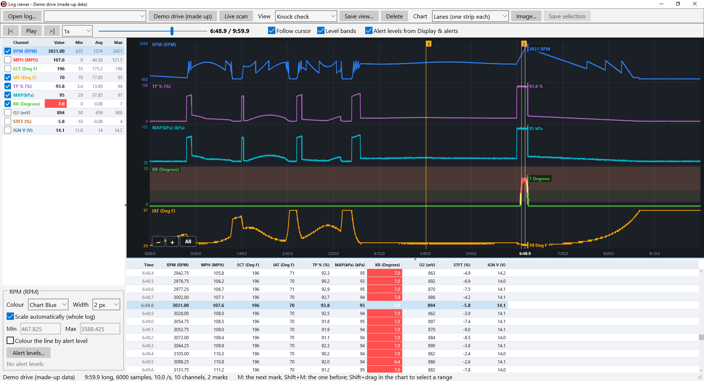

**Moving around:** click or drag in the chart to move the cursor (the grid jumps to that row); the mouse wheel zooms around the mouse; drag with the right mouse button to pan; double‑click to see the whole log. With the chart focused, ←/→ step one sample (Shift: 10), Home / End jump to the ends. Clicking a grid row moves the cursor there too. **Level bands** shades each channel's alert levels behind its line.

**Selecting a stretch:** hold Shift and drag in the chart. The stretch is shaded with its length, and the *Min\* / Avg\* / Max\** columns on the left show the values over just that stretch (for ON / OFF channels the average is how much of the time it was on) — e.g. select a wide‑open pull to see peak knock retard and average MAP. Enter zooms to the selection, Esc clears it.

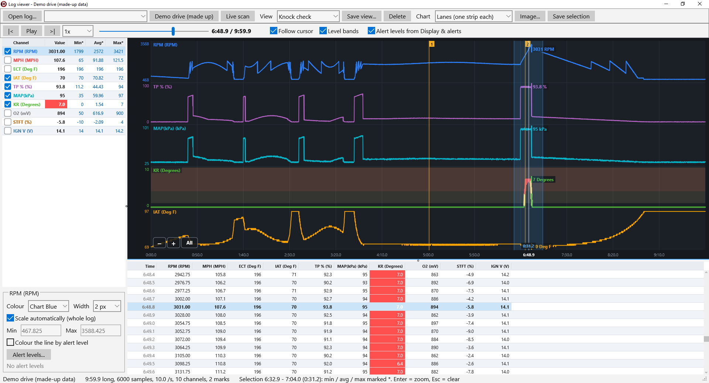

[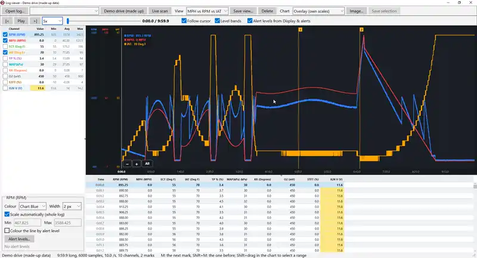](media/win-log-viewer.mp4)

**Image…** saves the chart as a PNG (for forum posts or a tuner). You can also drop a log file onto the viewer to open it, and after you stop logging, **F7** opens the log you just recorded.

**On a phone or a narrow window** the viewer is a page: the recent logs and **Demo** at the top, the playback buttons, then the chart above **Channels | Data** (one at a time). The selected channel's colour, scale and alert levels are on a page of their own — **Colour, scale, alerts: …** under the list. **⋮** holds the view set‑ups (pick, **Save view…**, **Delete view**), the chart mode, **Save chart picture** (saved next to the logs), **Follow the cursor**, **Level bands** and **Levels from Display & alerts**. Select a stretch by long‑pressing the chart (or **Select range**) and dragging. The back key (or arrow) leaves the channel page, then the viewer.

<p>
<a href="media/phone-log-viewer.mp4">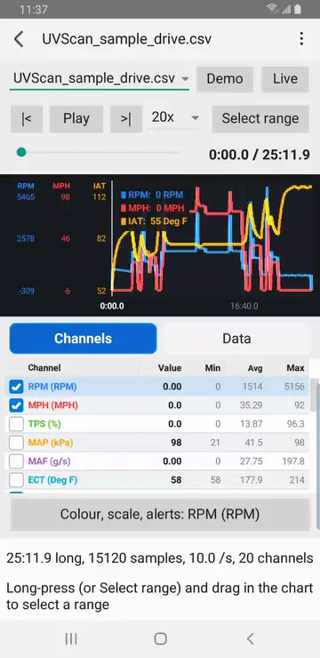</a>
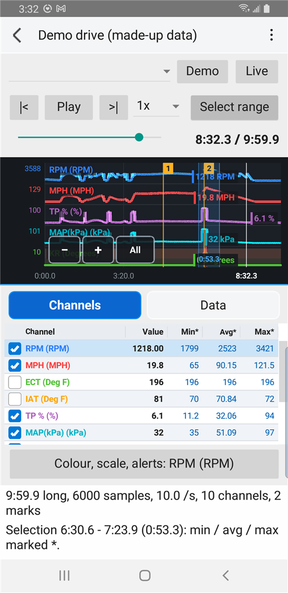
</p>

**Playback:** **Play** (or Space) runs the cursor through the log in real time — or at 0.25× to 20× — with the chart following (**Follow cursor**), the grid scrolling along and the values on the left updating, like watching the drive again. **|<** and **>|** jump to the start and end; the slider scrubs.

**Views:** **Save view…** stores the ticked channels, colours, widths, scales, alert levels and chart mode under a name; pick it in **View** to apply it to any log (channels are matched by name; ones the view does not list are hidden). The last view used is remembered. UVScan comes with a view for each of its [scan lists](#choosing-pids-and-scan-lists), plus *MPH vs RPM vs IAT*. Views live in `logviews.json`.

## Vehicle and trouble codes

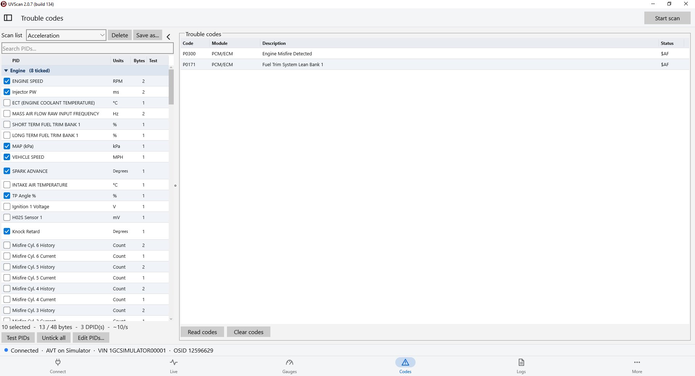

- **Read vehicle info** (on the *Connect* page) — VIN and PCM OS ID; the *Adapter* line says what is connected (*AVT, firmware 04 13* or *ELM327 v2.2*), and the status strip where (*ELM327 on COM4*).
- **Read codes** (**Codes** in the tab bar) — trouble codes from every module that answers (PCM, TCM, ABS, BCM, …) with descriptions from `dtcs.json`.
- **Clear codes** — asks first, then clears the PCM's codes (cycle the key and read again to confirm).

## Real‑time controls

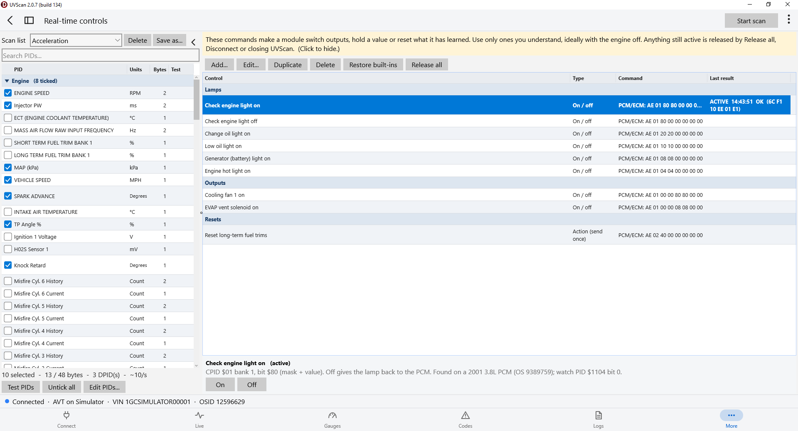

Real‑time controls (also called output tests, device control or special functions) make a module switch an output, hold a value or reset something it has learned — for example turn on the check engine light or reset the learned fuel trims. On GM Class 2 these are **mode $AE device control** requests.

**Every control here sends a command that changes what the PCM does.** Use only ones you understand, ideally with the engine off. Anything still active is released by **Release all**, by **Disconnect** and when UVScan closes; GM modules also drop device control by themselves a few seconds after the scan tool goes quiet.

Each control is one of four types:

| Type | Buttons | What happens |
|---|---|---|
| Action (send once) | **Send** | One command, e.g. a reset. |
| On / off | **On**, **Off** | *On* starts the control and keeps it active (UVScan keeps the session alive) until *Off* or *Release all*. |
| Hold to run | **Hold to run** | On while you hold the button down, off as soon as you let go. |
| Value | slider, **Apply**, **Release** | Sends the chosen value, e.g. an idle speed; *Release* gives control back to the PCM. |

The *Last result* column shows the module's answer — *OK*, or *refused* with the reason (for example *conditions not correct (engine running?)* or *request out of range*). Active controls are highlighted.

Controls work while scanning, so you can watch the PIDs they affect at the same time.

### Built‑in controls

| Control | Type | Command |
|---|---|---|
| Check engine light on / off | on / off | `AE 01 80 80 …` / `AE 01 80 00 …` |
| Change oil, low oil, generator, engine hot light on | on / off | `AE 01 20 20 …`, `10 10`, `08 08`, `04 04` |
| Cooling fan 1 on | on / off (asks first) | `AE 01 00 00 80 80 00 00` |
| EVAP vent solenoid on | on / off | `AE 01 00 00 08 08 00 00` |
| Reset long‑term fuel trims | action (asks first) | `AE 02 40 00 00 00 00 00` |
| Release all (return to normal) | action | `20` |

They were found and checked on a bench PCM (2001 3.8L, OS 9389759) by switching each output and watching the PCM's own status PIDs follow — see [protocol notes](protocol.md#device-control-mode-ae). Other PCMs may use other bits; if one is refused or does nothing on your vehicle, it does not apply there. **Restore built‑ins** puts back any you deleted, and new built‑ins from a newer UVScan are added once by themselves.

Several controls can be on at once: outputs that share a GM control packet (all the lamps, the fan and the EVAP vent are in CPID $01) are combined, so switching one off leaves the others on.

### Adding your own

If you know the command for something (from a service manual, a forum, or by logging what another scan tool sends), press **Add…**:

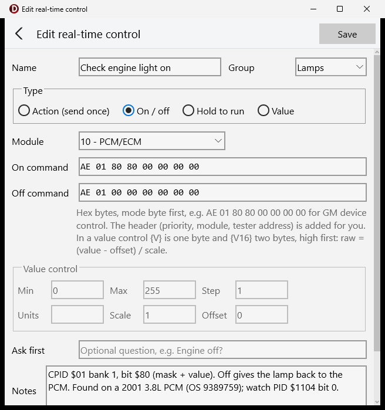

| Field | Meaning |
|---|---|
| Name, Group | How it is listed. |
| Type | Action, on / off, hold to run or value (see above). |
| Module | The module's bus address, e.g. `10` PCM, `18` TCM, `40` BCM. |
| On command / Command | Hex bytes starting with the mode byte, e.g. `AE 01 80 80 00 00 00 00`. The message header (priority, module, tester address) is added for you. |
| Off command / Release | What turns it off again (required for on / off and hold to run). |
| Value control | Min, max and step of the slider, units, and how the value becomes a byte: `{V}` (one byte) or `{V16}` (two bytes, high first) in the command is replaced by `raw = (value − offset) / scale`. |
| Ask first | A question to confirm before sending (leave empty for none). |
| Notes | Shown under the buttons. |

**Will send** shows the exact bytes, and the dialog explains what is wrong until the control is complete. Controls are saved in `controls.json`.

## Tools

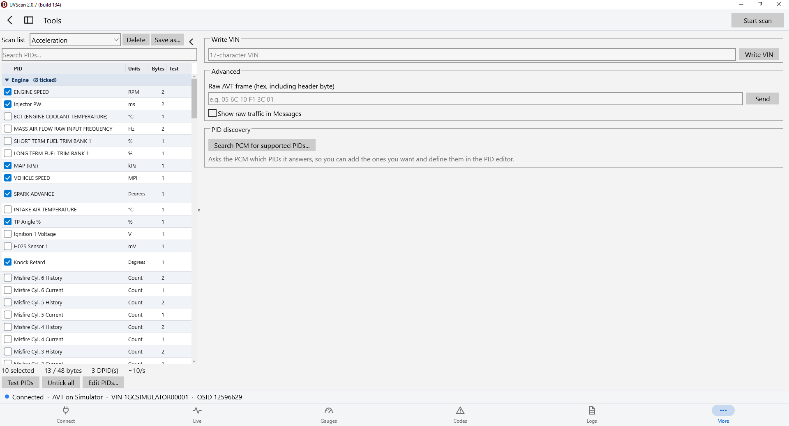

- **Write VIN** — writes a new 17‑character VIN to the PCM (asks first; turn the key off for 15 s afterwards).
- **Advanced** — send a raw AVT frame (hex) and see the reply in Messages, and show the raw bus traffic in Messages (**Show raw traffic in Messages**).
- **Search PCM for supported PIDs…** — see [below](#finding-pids-a-pcm-supports).

The log folder and the stream speed (fast / medium / slow; applies from the next scan) are in *More → Settings*.

## Editing PIDs

**Edit PIDs…** (under the PID list; not while scanning) opens the PID editor.

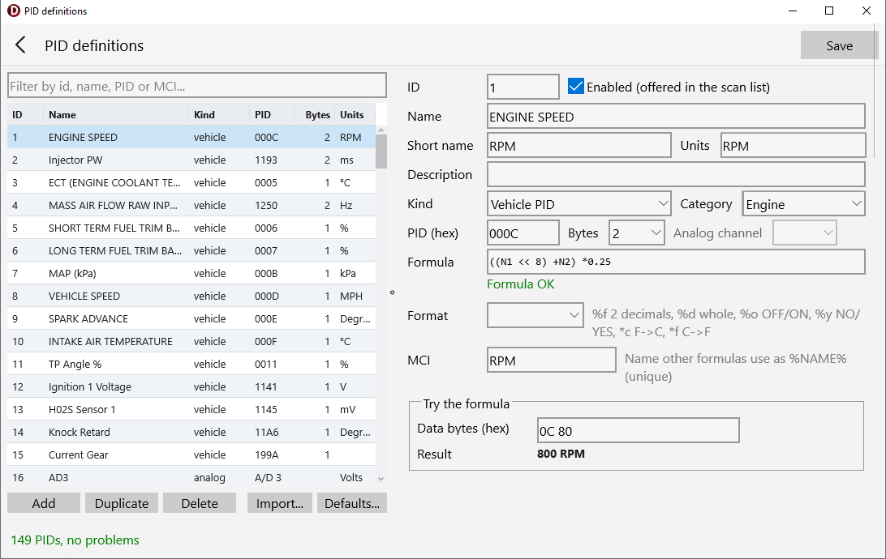

Every PID has a name, short name, category, kind and formula:

| Kind | Needs | Formula inputs |
|---|---|---|
| Vehicle | the PID number (`000C`, `11A6`, …) and its size in bytes | `N0`/`N1` = data byte 1, `N2` = byte 2, … |
| Calculated | — | other PIDs by their MCI name, e.g. `%RPM%`, plus `RUNTIME`, `LOGTIME` |
| Analog | AVT analog channel 1–3 | `N0` = the reading |

Formulas use `+ - * /`, `<< >>`, `& |`, comparisons and `? :` (e.g. `N0 > 127 ? N0 - 256 : N0`). The **Try the formula** box evaluates it with bytes or values you type. The problems panel lists everything that would stop the file loading; click one to jump to it. **Save** refuses to write while there are problems; the back arrow throws everything away. On a phone or a narrow window the editor is two pages: the list (tap a PID) and its details, with **All PIDs** (or the back key) to return to the list.

- **Import…** reads an old UVSCAN `PIDS.csv` and either adds only new PIDs, adds new and updates matching ones, or replaces the whole list.
- **Defaults…** adds the factory PIDs you are missing, or puts the factory list back completely.

## Finding PIDs a PCM supports

**Tools → Search PCM for supported PIDs…** (connected, not scanning) asks the PCM about every PID in the chosen ranges — standard SAE `$0000‑$00FF` (about 10 s), GM enhanced `$1000‑$1FFF` (about 2 minutes) and any extra ranges — using the read‑only mode `$22`.

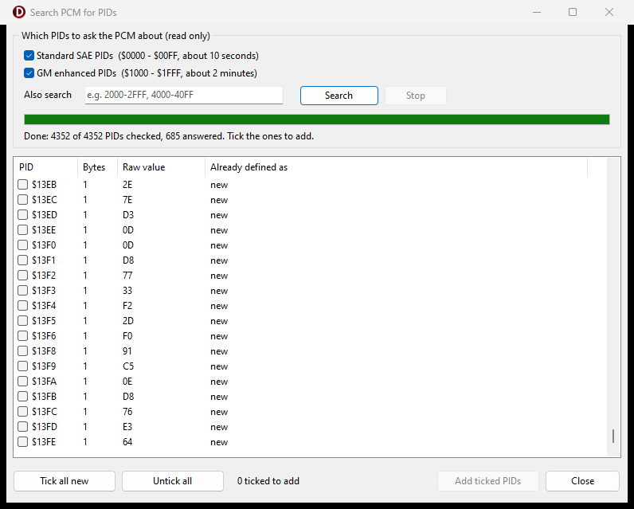

[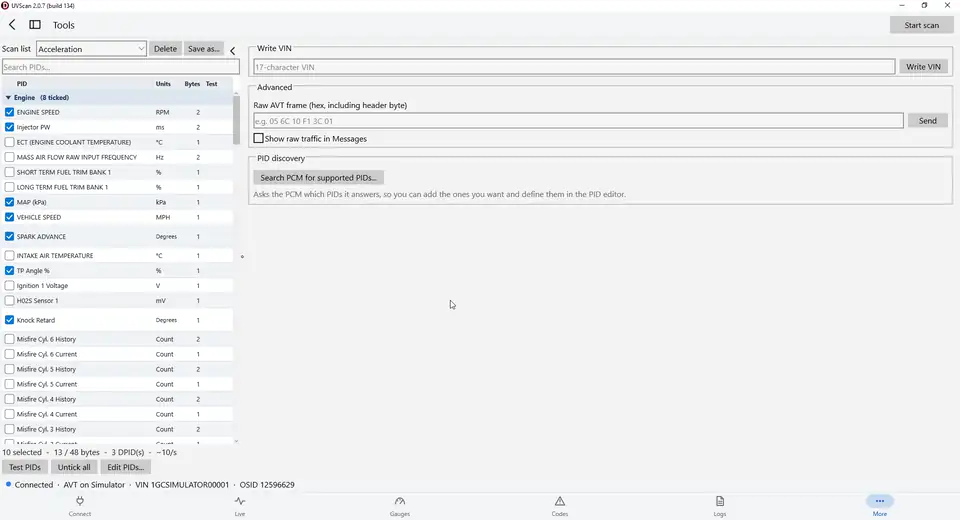](media/win-pid-search.mp4)

Each PID that answers is listed with its size, raw value and what it is already defined as. Tick the new ones and press **Add** (top right): they are added as `PID $xxxx` (category *Other*) and the PID editor opens filtered to them so you can name them and give them a formula — for example after logging them with the engine running to see what they follow.

## About

*More → About* shows the version (also in the Windows title bar, e.g. *UVScan 2.0.0 (build 98)*, and under *About* in the *More* list), who wrote UVScan, the source code on GitHub, and what this copy runs on. **Copy version info** puts that on the clipboard, for a bug report. The first line in *Messages* says the same. Under *Updates*: what the last update check found, **Check now** (or **Install 2.1.0** when there is a newer one) and **Check for updates at start** (see [Installing](#installing)).

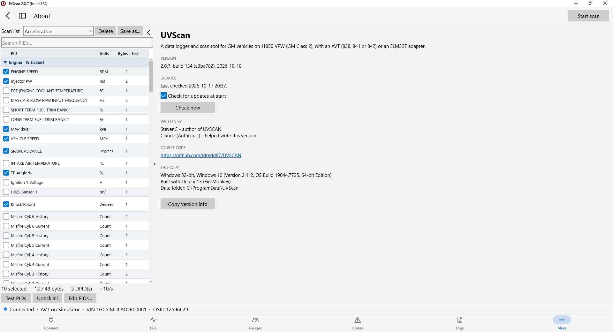

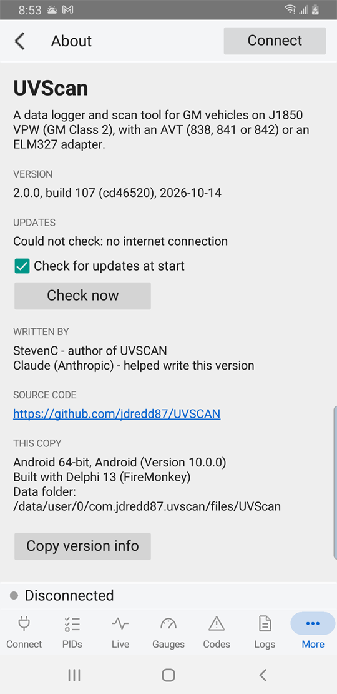

## Messages

Everything UVScan does is written here with a timestamp: connection steps, PCM answers and refusals, alerts, real‑time control results and, with **Show raw traffic in Messages** on (*Tools*), every frame sent and received.

## Keyboard and command line

| Key | Action |
|---|---|
| F7 | Log viewer |
| F8 | Start / stop log |
| F9 | Pause / resume log |
| F11 | Dashboard full screen / back |
| Ctrl + L | PID list beside the pages, or on its own page (wide windows) |
| Alt + Up / Alt + Down | Move the selected live data row |
| Ctrl + / Ctrl ‑ / Ctrl 0 | Zoom the live grid (Live data tab) |
| Ctrl + mouse wheel | Zoom the live grid |
| Space (log viewer) | Play / pause (live chart: pause / back to now) |
| ← → Home End (log viewer chart) | Step through the log |
| Esc | Close an open **⋮** menu; leave full screen; leave an editor (asking first if you changed something); in the log viewer chart, clear the selection |

```
UVScan.exe -port COM9 -connect -scan -log
UVScan.exe -list "Acceleration" -log -fullscreen -retry
UVScan.exe -quick "Drag strip"
```

| Switch | Does |
|---|---|
| `-port <name>` | The port: a COM port, `Simulator`, or an address such as `192.168.2.99:10001` for an AVT on the network. Without it, the port chosen last. |
| `-adapter <kind>` | `avt` or `elm327`. Without it, the adapter chosen last (a Bluetooth port on Android is always an ELM327). |
| `-list <name>` | Ticks the PIDs of this scan list. |
| `-dashboard <name>` | Shows this dashboard (otherwise the scan list's, if it has one). |
| `-connect` | Connects at start. |
| `-scan` | Starts scanning (connects first). |
| `-log` | Starts a log as well (scans first). |
| `-fullscreen` | The dashboard on the whole screen. |
| `-chart` | Opens the live chart once the scan runs. |
| `-retry` | Keeps trying to connect, every 3 seconds, until it works. |
| `-quick <name>` | Does what that [quick start](#quick-start) does; other switches add to it. |

Names with spaces go in quotes. These are what a desktop shortcut made by **Quick start → Desktop shortcut for one…** contains, so the easiest way to get one is to make it there.

## Where things are stored

Everything UVScan reads or writes, apart from CSV logs, is in **`C:\ProgramData\UVScan`**: `pids.json`, `lists.json`, `display.json`, `controls.json`, `logviews.json`, `dtcs.json` and `settings.json`. Missing files are created from the defaults built into `UVScan.exe`. See [data files](data-files.md) for the formats.

## Troubleshooting

| Problem | Try |
|---|---|
| *Could not open COM…* | Another program (or another UVScan) has the port. Close it, check the port in Device Manager. |
| *No answer from …* / *Could not connect to …* (network) | The AVT is off, on another network, or at another address or port. Check it answers from this PC or phone (same Wi‑Fi). |
| *… accepted the connection but no AVT answered* (network) | Something is at that address but it isn't answering as an AVT: the AVT is off behind its network module, or the address is another device's. |
| *No answer from an ELM327 adapter* | The adapter has no power (plugged in, key on?), the Bluetooth adapter is not paired or is connected to another phone or PC (it takes one at a time), the wrong port, or (USB) the wrong baud rate. Is the adapter set to **ELM327**? |
| *This ELM327 adapter does not support J1850 VPW* | The adapter cannot talk to a GM Class 2 PCM (common on cheap clones). Another adapter is needed. |
| An AVT‑841 says *No response from the AVT interface* | Is the adapter set to **AVT‑841**? |
| Connect works but no data | Key on? The status strip's update rate stays at 0 and a notice says *No data from the PCM*. Check the AVT's vehicle connection. |
| *Selected PIDs need N bytes; the limit is 48* | Untick some PIDs; the PCM cannot stream more than 48 bytes. |
| A PID shows *rejected* | The PCM refused it in a DPID. Use **Test PIDs**, or remove it. |
| A real‑time control is *refused* | The reason is in *Last result*. *Request out of range* means this PCM does not have that control; *conditions not correct* usually means the engine is running or the vehicle is moving. |
| No alert sounds | **Play alert sounds** in *More → Settings* must be ticked; check the level's sound with **Test**. |
